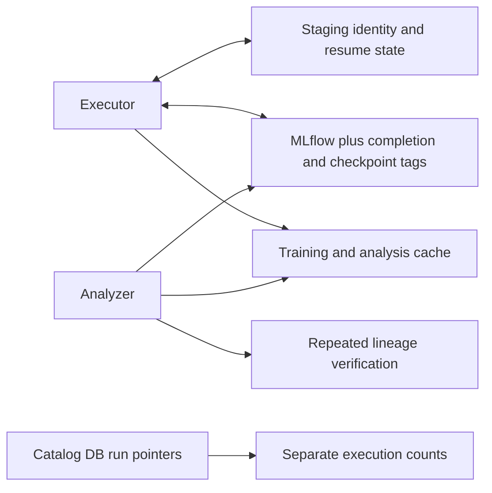
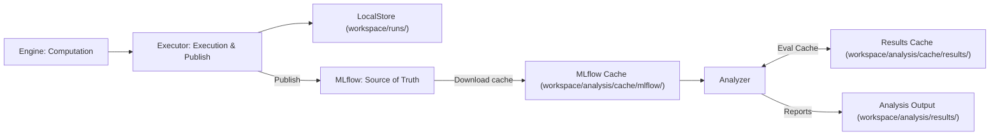

# F2 Word2Vec experiment lifecycle

F2/W2V1 and F2/W2V2 use MLflow as the only permanent record of experiment
execution. Corpus production and the research catalog remain separate domain
systems; neither records execution completion.

## Responsibilities before and after

| Component | Previous responsibilities | Current responsibility |
| --- | --- | --- |
| `w2v/tracked.py` | Search incomplete runs; match identities; restore remote checkpoints; synchronize completion tags; publish | Create a fresh MLflow run; invoke execution; publish required artifacts; terminate the MLflow run |
| `w2v/executor.py` | Train; identify existing staging; restore sessions and histories | Train a fresh session; atomically save scratch checkpoints; produce lookup, metrics and result artifacts |
| `repro_mlflow/checkpoints.py` | Remote generation registry, verified pointer tags, download verification, retention and automatic recovery | Removed |
| `w2v2/executor.py`, `preflight.py`, `phrases.py` | Prepare training data in the analysis cache | Prepare training data in staging |
| `w2v/cache.py` | No separate download boundary | Download MLflow metadata and analysis artifacts; expose a file-only reader |
| W2V1 `analysis.py`, `table3.py`–`table7.py` | Query MLflow; download artifacts/benchmarks; backfill caches from reports; calculate | Read cached run metadata, lookup, observations and benchmarks; calculate into cache |
| `w2v2/analysis.py` | Query MLflow; revalidate corpus/config/checkpoint/lineage identities; calculate | Read cached artifacts; calculate; report unavailable inputs |
| `w2v1/resources.py` | Resource acquisition was embedded in analysis modules | Explicit corpus/benchmark preparation outside analysis |
| Catalog repository and views | Store MLflow run pointers and infer execution/completion rates | Fully retired; experiment planning is driven by YAML suites and static manifests |

Before:

After:

`FINISHED` is the sole execution-completion signal. Synchronous artifact logging
must succeed before termination. Publication failures terminate the run as
`FAILED`. No `trial.status`, `result.durable_complete`,
`checkpoint.latest_verified`, staging execution identity or remote recovery
registry is created. Historical tags/artifacts are left untouched and are not
required for reading a completed run.

## Files and analysis

`workspace/runs/` contains training preprocessing, vocabulary files, checkpoints and
intermediate observations. When `override=True` is specified, existing run directories
are preserved intact, and the new run is stored in an indexed subdirectory (e.g. `run_01/`).
Atomic checkpoint writes, bounded matrix serialization, finite-value checks and
local retention remain. Native engine checkpoint serialization/restoration APIs
remain library mechanisms, not an automatic experiment recovery workflow.

The executor publishes `result.json`, lookup arrays and observations. Large-model
lookups reuse the final checkpoint directory. Already available canonical
benchmarks are copied to `evaluation/` before publication; execution does not
download benchmarks or change the training schedule to produce them.

`download_results()` refreshes a disposable MLflow metadata snapshot and downloads
analysis inputs into `workspace/analysis/cache/mlflow/`. The cache uses existing MLflow run IDs; it has no independent
execution identity or completion decision. Missing optional hardware or provenance
metadata does not invalidate usable accuracy measurements. The analyzer does not
require the original corpus, execution identity files, a separate vocabulary
snapshot or an additional full checkpoint when a standalone lookup exists.

W2V1 analysis entry points take a cache directory rather than a tracking URI.
W2V2 receives records from the same cached snapshot. The CLI owns the download
phase. `w2v2-report --offline` reads the existing local snapshot without MLflow.
W2V1 results live in `workspace/analysis/results/f2/w2v1/`; W2V2 results in
`workspace/analysis/results/f2/w2v2/`. Derived calculation caches live in
`workspace/analysis/cache/results/f2/<suite>/`. Explicit benchmark arguments refer to cached benchmark
files. Absent benchmarks or required artifacts produce unavailable analysis, with
no source-data download, staging lookup or repair attempt.

Basic safe-path checks, array/file validation and atomic cache publication remain.
Corpus/config/checkpoint lineage is recorded by execution and is not repeatedly
re-adjudicated by analysis. Published metadata may be displayed as provenance;
it is not another completion authority. Undefined scores and missing observations
are never replaced with experimental zeroes.

## Existing data and remaining persistence

No existing MLflow runs are modified or migrated. Local staging and caches can be
deleted. CSV-to-cache backfill is removed: a human-readable report cannot restore
an experimental input or establish execution completion.

The legacy catalog database has been removed. Experiment specifications, variants,
and planned slots are declared purely in YAML suites and static manifests
(`studies/f2/catalog/w2v.json`), while corpus production metadata and lineage
remain in the PostgreSQL `corpus` schema. Execution completion is tracked
exclusively via MLflow `FINISHED` status.

## Verification

`studies/f2/tests/test_w2v_cache.py` uploads existing-format fixture artifacts to a
test-owned MLflow store without training. For both suites it deletes staging,
performs cache-only evaluation with MLflow access forbidden, deletes the entire
cache, downloads again and compares evaluation results. No production service,
large corpus or research training run is used.
