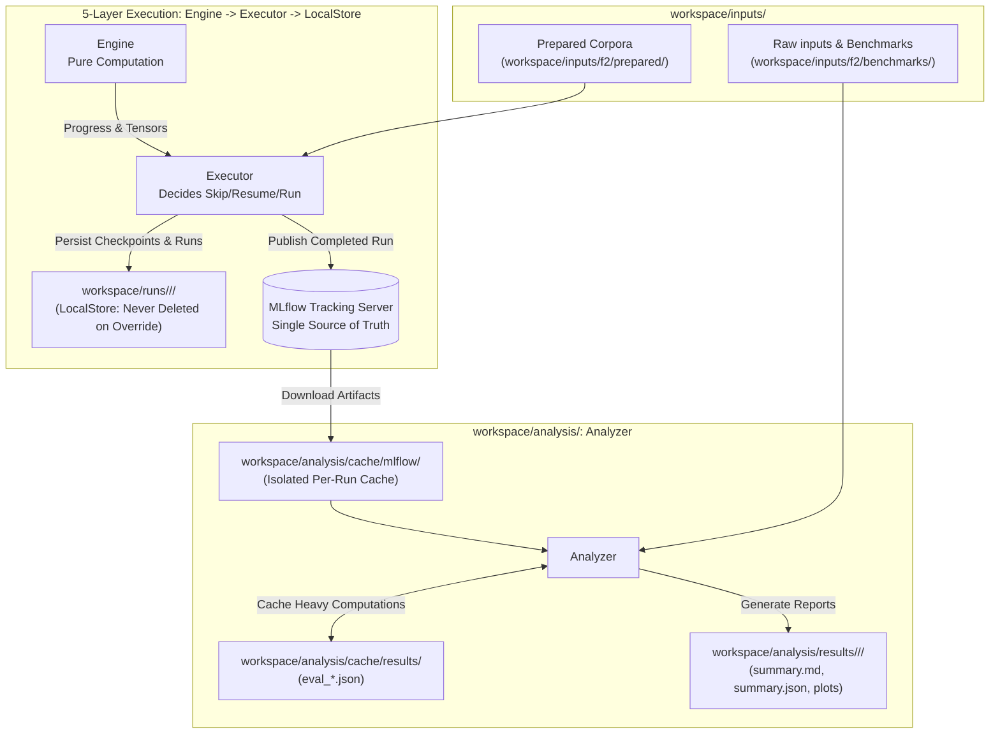

# Storage Policy, Caching & Path Resolution

This document specifies the exact lifecycle, storage tiers, and path resolution policies enforced across the monorepo.

---

## 1. Service Connection Contract

| Variable | Value and ownership | Consumer |
| :--- | :--- | :--- |
| `F1_MLFLOW_TRACKING_URI` | Externally operated F1 MLflow HTTP(S) endpoint | DLFS run, check, analyze, and tracked profile workflows |
| `F1_MLFLOW_DATABASE_URL` | F1 MLflow PostgreSQL backend credentials | Infrastructure operators only; application code must not read it |
| `F2_MLFLOW_TRACKING_URI` | Externally operated F2 MLflow HTTP(S) endpoint | F2 tracked workflows |
| `F2_MLFLOW_DATABASE_URL` | F2 MLflow PostgreSQL backend credentials | Infrastructure operators only; application code must not read it |
| `F2_DATABASE_URL` | Externally operated PostgreSQL instance; F2 owns only its `corpus` schema | F2 corpus CLI |
| `F2_CC_DATABASE_URL` | Dedicated `f2_cc` PostgreSQL database for Common Crawl operational state and releases | F2-CC CLI |

A tracking URI is an HTTP(S) application endpoint used by an MLflow client. A
database URL is a privileged direct PostgreSQL connection string; it must never
be substituted for a tracking URI or consumed by study runtime code. MLflow,
PostgreSQL, and S3-compatible services are operated outside this repository.
Neither this repository nor a study owns their service deployment, server-side
schemas, roles, buckets, backups, or availability. A study owns its client
connection contract and research-specific schemas and migrations only. There is
no cross-study or generic fallback.

For a tracked study command, resolution is `--tracking-uri`, then that study's
dedicated environment variable, then a clear error. Resolution trims whitespace
and removes trailing `/` characters only. F2 corpus and catalog commands are not
tracked and therefore do not expose a tracking option.

Real endpoints and credentials belong in the uncommitted `.env` or the deployment
secret manager. `.env.example` contains placeholders only. Database credentials
must not appear in logs, CLI arguments, committed configuration, or application
artifacts.

---

## 2. Storage Tiers & Data Lifecycle (Unified Workspace Policy)

All local execution, data materialization, and analysis artifacts are organized under `REPRO_WORKSPACE_ROOT` (`workspace/`):

```text
workspace/
├── inputs/
│   └── f2/
│       ├── corpus/
│       ├── prepared/
│       └── benchmarks/
├── runs/
│   ├── f2/
│   │   ├── w2v1/
│   │   └── w2v2/
│   └── dlfs/
└── analysis/
    ├── cache/
    │   ├── mlflow/
    │   └── results/
    └── results/
```



### 1) `workspace/inputs/` (Inputs & Preprocessed Data)
* **Purpose:** Local raw corpora, benchmark questions, and reusable prepared/preprocessed data.
* **Contents:**
  * `workspace/inputs/f2/corpus/`: Raw text files.
  * `workspace/inputs/f2/prepared/corpus/`: Materialized shards and binding manifests generated by `CorpusMaterializer`.
  * `workspace/inputs/f2/benchmarks/`: Canonical evaluation question sets (`questions-words.txt`, `questions-phrases.txt`).

### 2) `workspace/runs/` (Execution Runs & Checkpoints — Full Preservation)
* **Purpose:** Local execution working state, checkpoints, observations, and completed run artifacts.
* **Contents:**
  * `workspace/runs/<study>/<suite>/<slot_or_variant>/`: Lookups, `checkpoints/`, `metrics/observations.csv`, `result.json`.
* **Policy:**
  * Local runs are preserved by default. When an execution is re-run with `override=True`, the prior run directory is NOT wiped; the new run is written to an indexed subdirectory (e.g. `run_01/`, `run_02/`).
  * Completion is judged by `PathRunLocator` requiring `complete=true` in `result.json` and all declared artifacts to physically exist on disk.

### 3) `workspace/analysis/cache/` (Reconstructible Derived Caches)
* **Purpose:** Process-safe caching of downloaded MLflow artifacts and heavy evaluation computations.
* **Contents:**
  * `workspace/analysis/cache/mlflow/`: Local download cache from MLflow (`<server_key>/<run_id>/`). Each run is isolated in its own folder to prevent cross-run pollution.
  * `workspace/analysis/cache/results/`: Signature-checked per-run analogy evaluation cache (`eval_<run_id>_<table>.json`), caching time-consuming accuracy metrics.

### 4) `workspace/analysis/results/` (Human-Facing Deliverables)
* **Purpose:** Publication-grade comparison tables, charts, and summaries.
* **Contents:**
  * `workspace/analysis/results/<study>/<suite>/`: `summary.md`, `summary.csv`, `summary.json`, and charts (`.png`, `.pdf`).

---

## 3. External services and study-owned data contracts

**1) Externally managed MLflow services:**
All production run artifacts, checkpoints, manifests, and time-series metrics are
uploaded to an externally operated MLflow endpoint selected by the study contract.

* The project root filesystem does **NOT** store raw run dumps during production runs.
* MLflow stores:
  * Full run configurations and parameter hashes
  * Time-series metrics (loss, accuracy, perplexity, elapsed times)
  * Generational checkpoints:
    * `checkpoints/generations/<role>-epoch-<E>-update-<U>-<digest>/`:
      * `model_parameters.npz`
      * `model_buffers.npz`
      * `objective_parameters.npz`
      * `objective_buffers.npz`
      * `optimizer_state.pkl`
      * `trainer_state.pkl`
      * `rng_state.pkl`
      * `manifest.json`
    * Pointers: `latest.json`, `best.json`, `final.json`
  * Lineage manifests (`result_manifest.json`, `checkpoint_manifest.json`)
* Upload verification (`_verify_uploaded_manifest`) ensures that runs are only marked `result.durable_complete = true` when all artifacts are durable in MLflow.

**2) PostgreSQL Databases:**
* **`F2_DATABASE_URL`:** Externally operated PostgreSQL database; F2 owns the definitions and migrations of its `corpus` schema only.
  * **Schema `corpus`:** Transaction-safe operational state storage for Common Crawl candidate sampling, feature extraction diagnostics, gold human audit labels, generic acquisition runs, immutable artifact metadata, multi-hop processing DAG lineage, and validation evidence.
* **`F2_CC_DATABASE_URL`:** Physically separate `f2_cc` database owned by the
  `f2-cc` study. It stores URL-level candidates, range acquisition, extraction,
  audits, analysis profiles, stage lineage, and published release manifests.
  F2 consumes only a completed release manifest, never CC operational rows.
* **Corpus Artifact Object Storage (S3-compatible):** Actual corpus binary files, raw archive dumps, intermediate extracts, and canonical tokenized/sharded text files reside in an externally operated object store. F2 defines logical key layout and records object identities, hashes, counts, lineage, and validation evidence in its own schemas; it does not operate the store.
  * **S3 URI Layout:** `raw/<source>/<release>/...`, `processed/<source>/canonical/shard-XXXXX.txt.zst`, `processed/<source>/normalized/shard-XXXXX.txt.zst`, `manifests/<source>/...`.
  * **Remote Worker Tailscale HTTPS:** Exposed over Tailnet via Tailscale Serve at `https://<tailnet-host>:9000` (`F2_CORPUS_S3_ACCESS_KEY` / `F2_CORPUS_S3_SECRET_KEY`, path-style addressing).

---

## 4. 3-Tier Dataset Path Resolution Precedence

To allow `deepscratch` to run both as a standalone library and inside monorepo studies, dataset paths are resolved using a 3-tier fallback precedence:

```
Tier 1: Explicit Parameter (data_dir=...)
   │ (if None)
   ▼
Tier 2: Environment Variable ($DEEPSCRATCH_DATA_DIR)
   │ (if unset)
   ▼
Tier 3: Default Local Fallback (./data/<dataset>)
```

### Study-Level Path Injection (Dependency Injection)
Inside `studies/dlfs`, explicit dataset paths are injected from `repro-core`'s central resolver via translation adapters:

```python
# In studies/dlfs/src/dlfs/ds1/implemented/adapters/data.py
def load_ds1_mnist(*, flatten: bool = True, gpu: bool = False, paths=None):
    runtime_paths = paths or RuntimePaths.from_environment()
    data_dir = runtime_paths.dataset("mnist")
    return load_mnist(flatten=flatten, gpu=gpu, data_dir=data_dir)
```

---

## 5. Path Environment Variable Overrides

All storage roots can be overridden via environment variables for CI, remote cluster mounting, or high-performance scratch drives:

| Environment Variable | Default Path | Purpose |
| :--- | :--- | :--- |
| `REPRO_DATA_ROOT` | `./data` | Canonical dataset root |
| `REPRO_ARTIFACTS_ROOT` | `./artifacts` | Human-facing analysis deliverables |
| `REPRO_CACHE_ROOT` | `./.cache` | Reconstructible cache storage |
| `REPRO_STAGING_ROOT` | `./.staging` | Ephemeral scratch directory |
| `REPRO_REFERENCES_ROOT` | `./references` | Upstream vendored baselines |


## Database and corpus I/O configuration

Explicit connection_url bypasses environment resolution. Without it, an existing
non-empty F2_DATABASE_URL wins immediately. Otherwise load_dotenv(override=True)
is attempted using its existing discovery behavior and F2_DATABASE_URL is read.
No subsystem or legacy database aliases are consulted. Missing configuration raises
DatabaseConfigError; there are no built-in localhost
credentials. An unavailable dotenv loader does not suppress the final error.

F2_TEST_DATABASE_URL is read only by test fixtures, never from dotenv. Without it,
tests create and clean up a temporary PostgreSQL 18 Podman/Docker container. They
bootstrap corpus and fail if no test DB can be started; DB tests do
not skip or fall back to application settings. A supplied test URL must identify a
dedicated test database; test data and migrations are written there.

F2_CORPUS_S3_{ENDPOINT,ROOT,ACCESS_KEY,SECRET_KEY,REGION} configures general corpus
storage. F2_GIGAWORD_S3 uses the same suffixes for restricted storage. ENDPOINT,
ROOT, ACCESS_KEY and SECRET_KEY are required; ROOT must begin with s3://; REGION
alone defaults to us-east-1. F2 interprets these variables and selects restricted
access; repro-io receives only explicit S3Config values. No secrets belong in artifacts.

Run records belong to MLflow, corpus bytes to object storage, and F2 metadata to
PostgreSQL. Dataset paths and existing cache/staging locations are unchanged.
See [infra handoff](../../infra/README.md) for the external operator interface.
The repository does not deploy, administer, back up, or restore these services.

## F2 Word2Vec lifecycle

F2/W2V1 and W2V2 use MLflow `FINISHED` as the sole authority for run completion; the generic `result.durable_complete` convention does not apply. Training runs write local results and checkpoints to `workspace/runs/f2/<suite>/`, fully preserving past runs on override. Materialized corpora reside in `workspace/inputs/f2/prepared/corpus/`. Analyzers read cached MLflow inputs from `workspace/analysis/cache/mlflow/`, store computation caches in `workspace/analysis/cache/results/`, and write final deliverables to `workspace/analysis/results/f2/<suite>/`. The legacy catalog database has been removed; experiment planning and execution are driven directly by YAML suites and static manifests. See [F2 experiment lifecycle](../architecture/f2-experiments.md).
